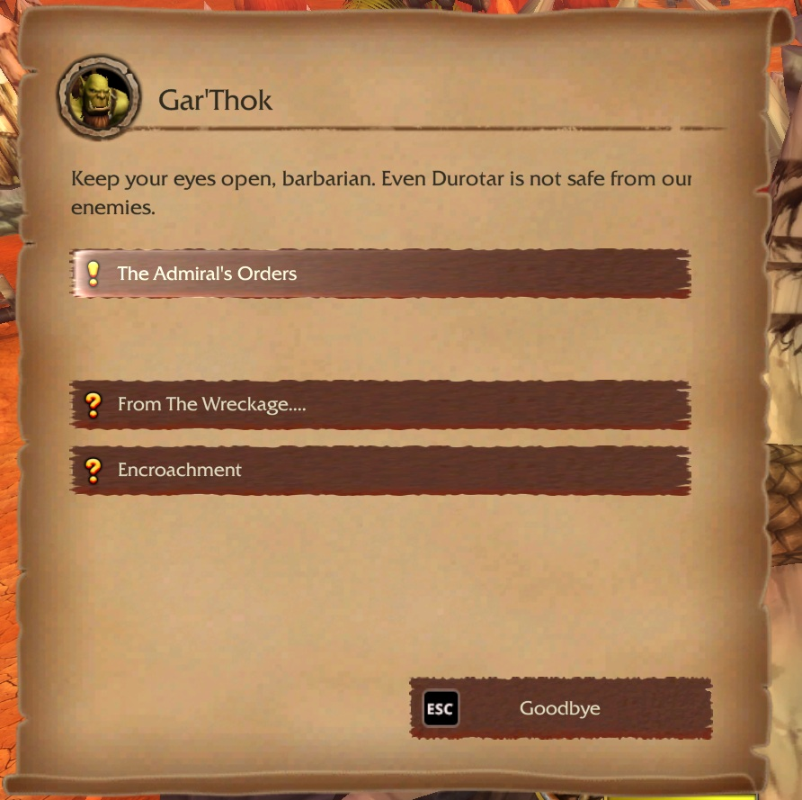
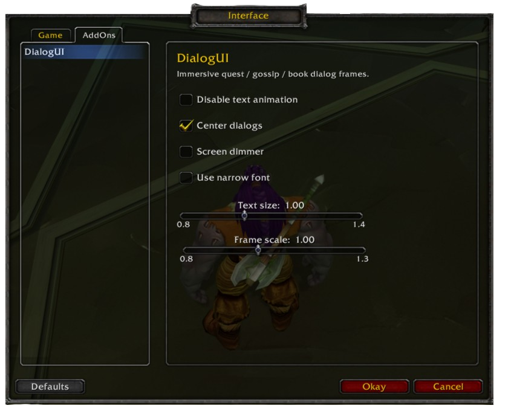

# DialogUI (WotLK 3.3.5a) revised

Immersive quest / gossip / book dialog frames for WoW 3.3.5a. Replaces the
default Blizzard frames with parchment-styled panels.

Fork of [Stefan2102's WotLK port](https://github.com/Stefan2102/DialogUI-WotLK).

## Additions in this port

**Added / Fixed**
- BookFrame added in focus mode & screen dimmer modes
- "Space" and "ESC" indicators added to buttons in Gossip and Quest-Frames
- Adjustment of all frame sizes and locations on screen
- Adjustment of font sizes and spacing
- Replacement of parchment frame picture

## Screenshots

## Credits

- Original: [Sxus](https://github.com/Jslquintero/DialogUI)
- WotLK port: [Bset](https://github.com/ghbset/DialogUI-WotLK)
- Inspiration: [DialogueUI](https://www.curseforge.com/wow/addons/dialogueui)
